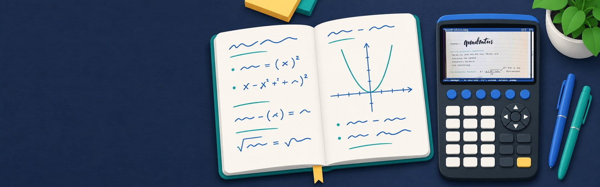
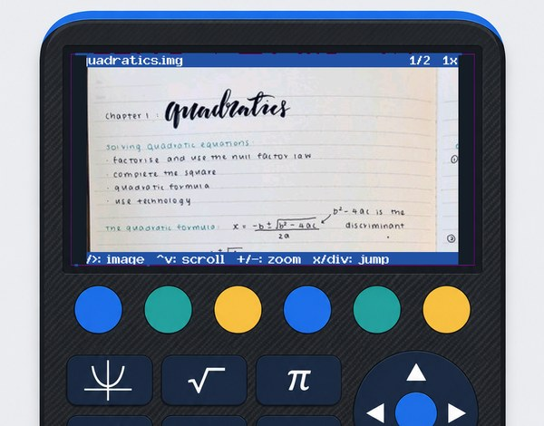
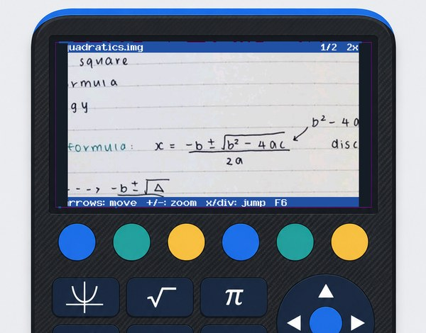
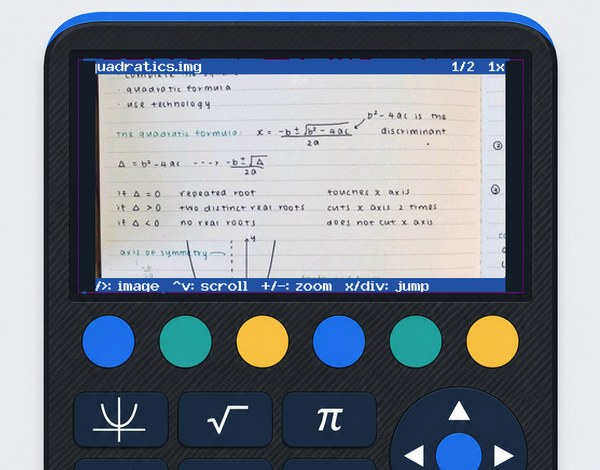
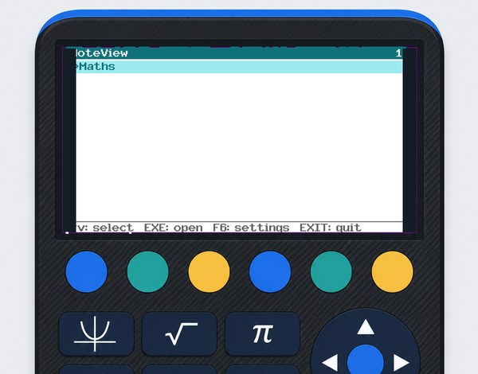
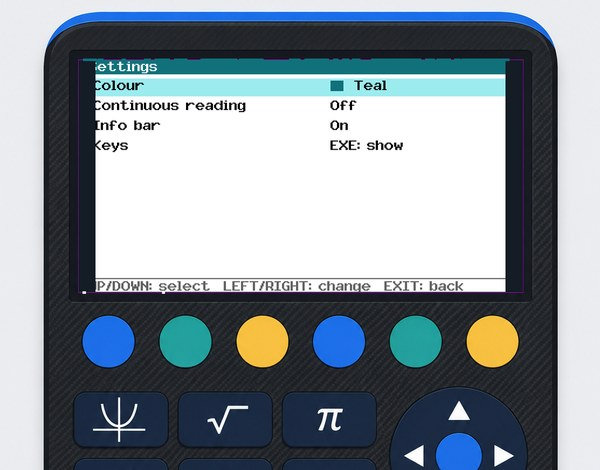
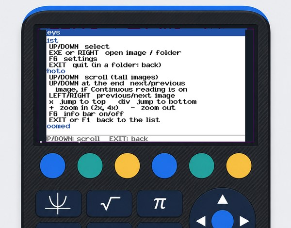

# NoteView for the Casio fx-CG50

View your photos and photographed notes on a Casio **fx-CG50** (also sold as **Graph 90+E**), full screen and sharp.

| | |
|---|---|
|  |  |
| A photo of a notebook page, full screen width | Zoomed in 2x: real detail, not blown-up pixels |
|  |  |
| Tall pages scroll | Folders, and 8 colour themes |
|  |  |
| Settings | Every key explained on the calculator |

The calculator pictures are illustrations; the screens are real screenshots of the app.

- Photos fill the whole screen width; tall photos (pages, portraits) keep their full height and you scroll them.
- Zoom 2x and 4x with real detail, move around with the arrows.
- **Notebook pages are cleaned up** on the PC: shadows removed, paper white, ink darker.
- Folders, continuous reading (scroll from one page into the next), 8 colour themes.
- Remembers where you were: reopening the app brings you back to the same page and spot.
- One command (or a double-click on Windows) converts your photos and copies them to the calculator.

## What you need

- A Casio fx-CG50 / Graph 90+E and its USB cable. (Older fx-CG10/20 are untested.)
- A computer with [Python 3](https://www.python.org/downloads/). On Windows, tick **"Add python.exe to PATH"** in the installer.
- Pillow, the image library: open a terminal in this folder and run `pip install -r requirements.txt` (or `pip install pillow`).

## Get your photos on the calculator

1. Download this project ("Code" > "Download ZIP" on GitHub) and unzip it.
2. Put your photos (jpg, png, bmp, gif, webp, tif) in the **`photos`** folder. Subfolders become folders on the calculator, e.g. `photos/Maths/page1.jpg`.
3. Connect the calculator with the USB cable and press **F1 (USB Flash)** on it.
4. **Windows:** double-click **`upload.bat`**. **Mac/Linux:** run `python3 convert.py` in this folder.
5. When the calculator shows "Updating", wait until it is done, then unplug it. Open **NoteView** from the MENU.

The tool converts the photos, copies the app (`NoteView.g3a`) and the photos to the calculator, and ejects it. It only adds files: it never deletes or changes anything else on your calculator. Photos that did not change are not converted or copied again. If no calculator is connected, it just converts; run it again later.

### Options

Add them after the command, e.g. `upload.bat --contrast high` or `python3 convert.py --contrast none`.

| Option | Default | What it does |
|---|---|---|
| `--contrast none\|low\|normal\|high` | `normal` | Cleanup for **photos of notebook pages**: removes shadows, makes the paper white and the ink darker (pen colours are kept). `low` is gentler, `high` stronger. **Use `none` for ordinary photos** (people, places), or they will look like a drawing. |
| `--small` | off | No zoom detail: files about 5x smaller, so more photos fit, but zoom is blocky. |
| `--no-upload` | off | Only convert, don't touch the calculator. |
| `input_dir` `output_dir` | `photos`, `converted` | Use other folders. |

Tip: put ordinary photos and notebook pages in separate runs, e.g. `python3 convert.py my_holiday --contrast none`.

How big? A phone photo of a page is about 150-200 KB, an ordinary photo 30-150 KB; the calculator has about 16 MB of storage. Very wide photos are cropped at the sides; very tall ones keep their top 5 screens.

## Keys

The app shows this list on its first start, and any time in **F6 Settings > Keys**.

| Screen | Keys |
|---|---|
| List | UP/DOWN select, **EXE** open photo or folder, **F6** settings, **EXIT** quit (in a folder: back) |
| Photo | **UP/DOWN** scroll, **LEFT/RIGHT** previous/next photo, **+ / −** zoom, **×** jump to top, **÷** jump to bottom, **F6** info bar on/off, **EXIT** back to the list |
| Zoomed | arrows move, **+ / −** zoom, **× / ÷** top/bottom, **EXIT** back to normal size |
| Settings | UP/DOWN select, LEFT/RIGHT or EXE change, EXIT back |

**Settings:** colour of the bars (8 themes), **continuous reading** (at the bottom of a page, DOWN goes on to the next page; UP at the top goes back), and whether the info bar is shown.

The app remembers where you were in a small file `NoteView.cfg` on the calculator; delete it to start fresh.

## Put files on the calculator yourself

You can also copy files by hand: `NoteView.g3a` to the root of the calculator, and the `.img` files from `converted/` to the root or into folders (one level). Other image formats are not shown; convert them with `convert.py --no-upload` first.

## Build from source

The add-in is C, built with the [fxSDK and gint](https://git.planet-casio.com/Lephenixnoir/fxsdk) by Lephenixnoir: `fxsdk build-cg` in this folder makes `NoteView.g3a`. The `.img` format is described in `src/view.h`: JPEG strips of 112 rows at 396 and 792 px width, so the calculator only decodes what is on screen.

## Credits and licence

- MIT licence, see [LICENSE](LICENSE).
- JPEG decoding: [TJpgDec](http://elm-chan.org/fsw/tjpgd/) R0.03 by ChaN (`src/tjpgd*`, its own licence in the file headers).
- Built on [gint](https://git.planet-casio.com/Lephenixnoir/gint) and the fxSDK by Lephenixnoir.
- Not affiliated with CASIO.

## Updating the README pictures

`docs/*.png` are emulator screenshots; `docs/art/` holds the illustrations (their calculator screens are pure magenta). `python docs/make_mockups.py` pastes the screenshots into them and writes `docs/mockup-*.jpg`, `docs/banner.jpg` and `docs/social.jpg` (the GitHub social preview: Settings > Social preview).
